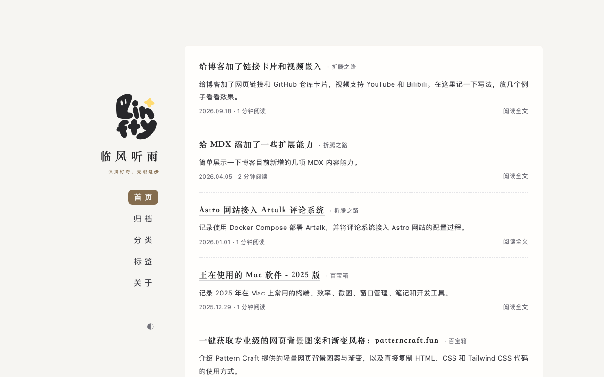
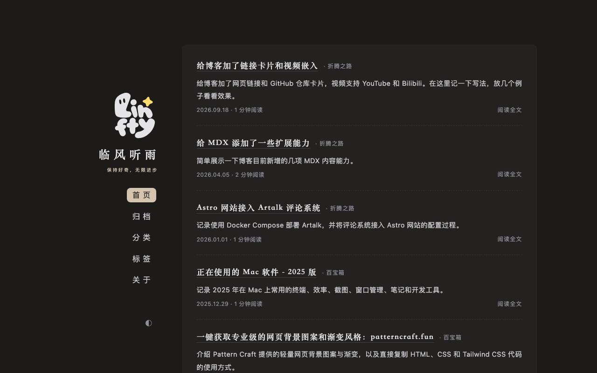

# linfty.com

个人博客，使用 Astro + Tailwind CSS 构建，目前的设计与排版是参考 [Qiwi](https://github.com/lanbinleo/qiwi) 主题 - 这是 [Leo](https://leoreo.me/) 开发的 Typecho 主题。





## 快速开始

需要 Node 22.23.4 以上。

```sh
pnpm install
pnpm dev
```

开发服务器默认在 http://localhost:4321。其他命令：

- `pnpm build`：生产构建，产物输出到 `dist/`
- `pnpm preview`：本地预览构建结果
- `pnpm assets`：修改 `src/assets/brand/` 后重新生成 favicon 和 OG 图

## 许可

MIT
